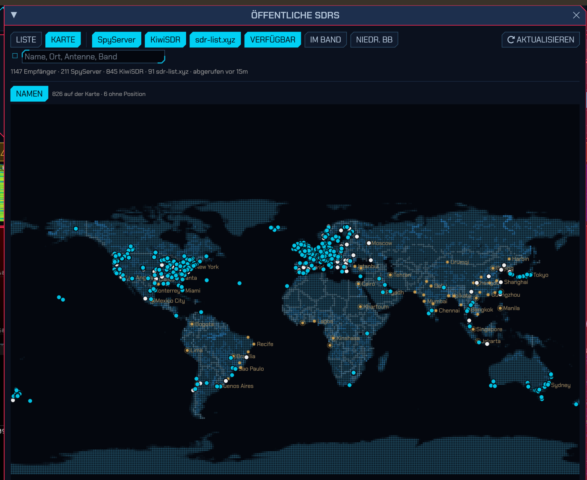
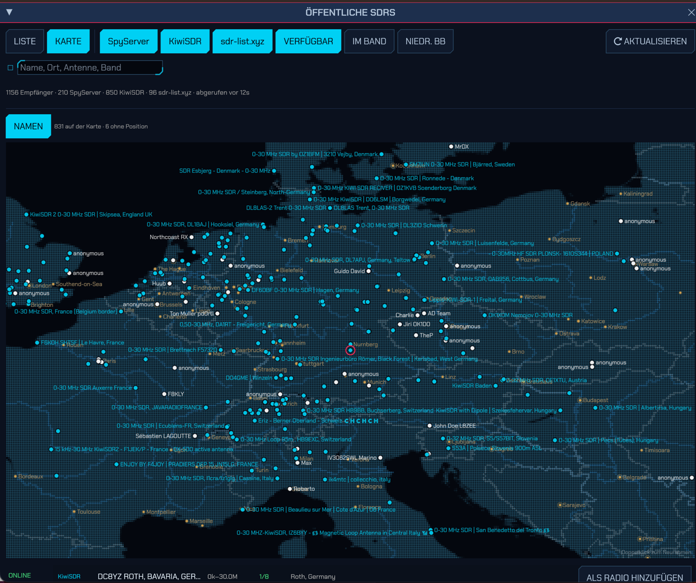
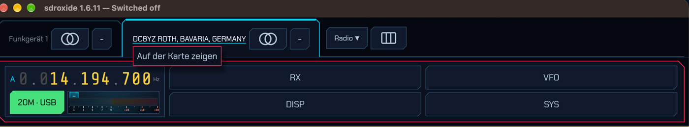
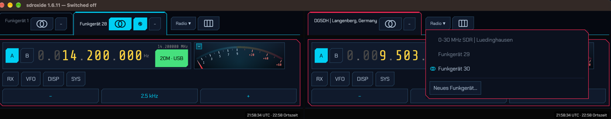
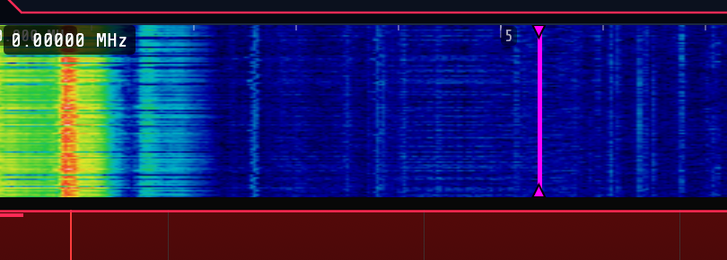
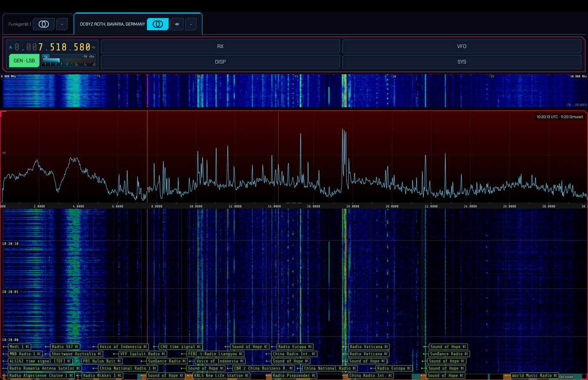
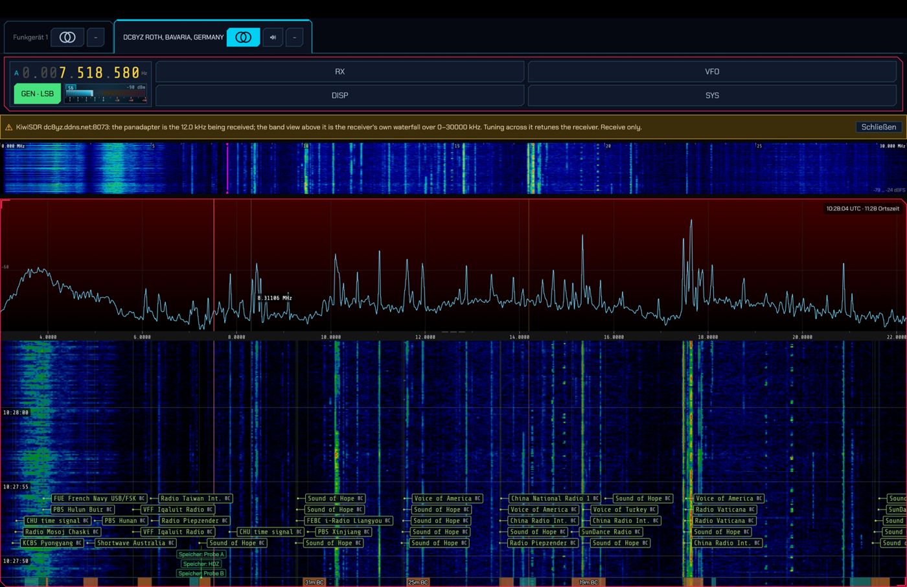
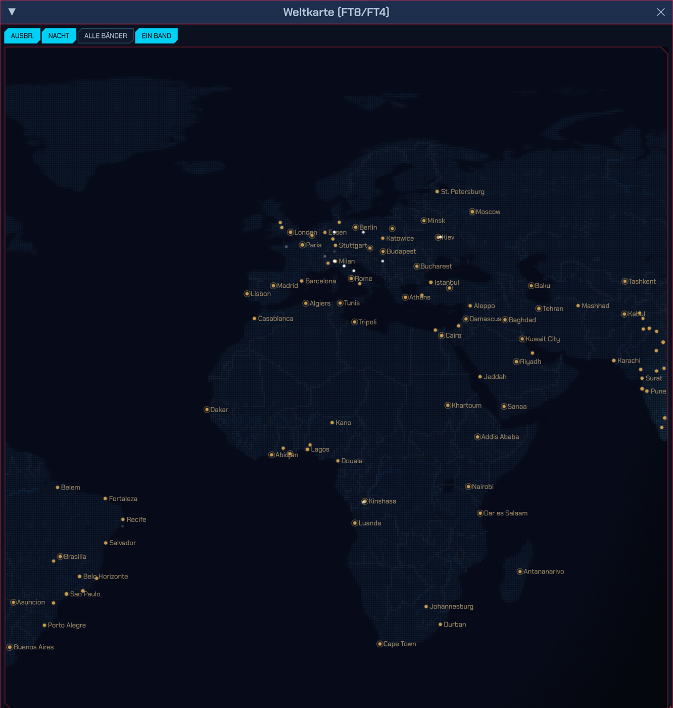
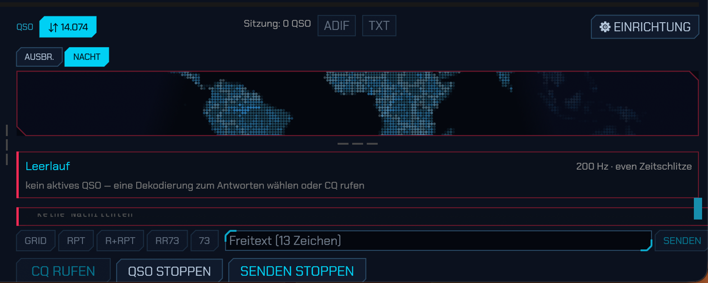
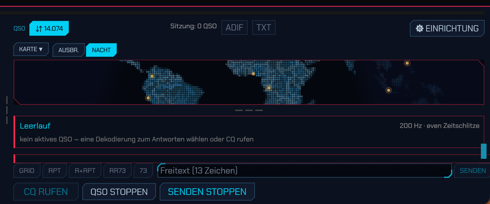

# SDR Oxide — patch previews

This branch of the fork shows, with screenshots, the changes proposed to [SDR Oxide](https://github.com/dividebysandwich/sdroxide) from this fork. Every patch is offered upstream as an issue or a pull request; this page is where they can be seen before anyone applies them. **Comments are welcome** in this fork's [Discussions](https://github.com/HDZucht/sdroxide/discussions) or in the linked issue.

**Updated 2026-11-07:** each patch applies to upstream `main` at `d10ae79c` (v1.7.0) on its own, unless its line below names a patch it builds on. All of them apply together as well, with the #776 version of #777. Measured with `git apply` on a fresh checkout. The four suggestions upstream has merged (PRs #780, #781, #782, #788) are marked below; their patch files are gone from this branch.

For a coding agent (or anyone applying several patches): [`AGENTS.md`](AGENTS.md) lists the base commit, which patch needs which, how to resolve conflicts, the macOS build settings and the checks.

To try one:

```sh
git clone https://github.com/dividebysandwich/sdroxide && cd sdroxide
git checkout d10ae79c
curl -sL https://raw.githubusercontent.com/HDZucht/sdroxide/previews/patches/sdroxide-ft8-map-window.patch | git apply
cargo run --release
```

---

## Public SDRs

### Map, ADD AS RADIO, ONLINE / SILENT — [#772](https://github.com/dividebysandwich/sdroxide/issues/772)

LIST | MAP over the Public SDRs window: one dot per receiver, the search flies the map to what it finds, a click picks every receiver under the pointer. ADD AS RADIO makes the receiver a radio of its own, named after its directory entry. Each picked receiver is checked ONLINE or SILENT. NAMES and CITIES switch the map's labels and cities. The window keeps its size.



Now **PR [#799](https://github.com/dividebysandwich/sdroxide/pull/799)** (branch `pr/public-sdr-map` of this fork, two commits with #777). The map fills its window: the rows under it are a bottom panel laid out first, so the window can be resized freely in both directions.

Patch: [`sdroxide-publicsdr.patch`](patches/sdroxide-publicsdr.patch) · applies to `main` (the PR's first commit).

### The tab's name leads back to the map — [#777](https://github.com/dividebysandwich/sdroxide/issues/777)

A click on the name of the radio shown, when that radio is a KiwiSDR or SpyServer, opens the map on its receiver. Last known positions are remembered; a receiver gone from the directory is shown as a dashed ring where it was last seen.





Patches: [`sdroxide-tab-map-link-main.patch`](patches/sdroxide-tab-map-link-main.patch) on `main` + #772 (the second commit of PR #799) · [`sdroxide-tab-map-link.patch`](patches/sdroxide-tab-map-link.patch) on `main` + #776 + #772.

---

## Panes and station

### A row of picked radios per pane — [#776](https://github.com/dividebysandwich/sdroxide/issues/776)

Each pane carries a row of the radios picked for it; "Radio ▼" puts another one there, "−" takes one off the row (it keeps running). The link rings sit on the tabs.



Patch: [`sdroxide-panes-pick.patch`](patches/sdroxide-panes-pick.patch) · applies to `main`.

### The station radio, framed — [#775](https://github.com/dividebysandwich/sdroxide/issues/775)

Settings → Radio frames the station radio (the first in `radios.json`, the one spot feeds, rotator, amplifier and `/ws` belong to) and heads it "Station:".

Patch: [`sdroxide-station-mark.patch`](patches/sdroxide-station-mark.patch) · applies to `main`.

---

## Display

### The tuned frequency on the full-band strip — [#769](https://github.com/dividebysandwich/sdroxide/issues/769) · PR [#782](https://github.com/dividebysandwich/sdroxide/pull/782)

A magenta line at the tuned frequency, with triangles on the strip's edges.



**Merged upstream** as PR #782 (in v1.7.0).

### Spot labels above the band plan — [#779](https://github.com/dividebysandwich/sdroxide/issues/779) · PR [#781](https://github.com/dividebysandwich/sdroxide/pull/781)

Network spot labels stack above the band-plan strip and the memory marks instead of over them.

| Before | After |
|---|---|
|  |  |

**Merged upstream** as PR #781 (in v1.7.0).

### External links open on the desktop — [#778](https://github.com/dividebysandwich/sdroxide/issues/778) · PR [#780](https://github.com/dividebysandwich/sdroxide/pull/780)

Links in the program (manual, receiver pages, wiki) open in the system browser on macOS; eframe's `links` feature was off.

**Merged upstream** as PR #780 (in v1.7.0).

---

## KiwiSDR

### Centre the 12 kHz I/Q on a dial at rest — [#770](https://github.com/dividebysandwich/sdroxide/issues/770)

Once the dial has rested 5 s, the KiwiSDR's 12 kHz I/Q is centred on it again.

Patch: [`sdroxide-kiwi-c-dwell.patch`](patches/sdroxide-kiwi-c-dwell.patch) · applies to `main`.

---

## FT8 / FT4

### The world map in a window of its own, who is talking to whom, station info — [#786](https://github.com/dividebysandwich/sdroxide/issues/786)

- **MAP ▼** over the map (in the QSO header on a compact layout, which has no map in the column): open the map in a floating window as big as it is dragged; cities, who is talking to whom, callsigns at the dots.
- **Who is talking to whom:** a violet dotted great circle between both ends of every exchange heard in the last ten minutes where both have sent a locator.
- **A click on a dot** picks the station as a click on its decode row does; under the map two lines say what is known: entity, continent, CQ zone, grid, distance, heading, new or worked, the last message with its report and time.
- Stations and links stay ten minutes, fading.



The screenshot shows an earlier state of the window; the chip row is one MAP ▼ menu now.

Patch: [`sdroxide-ft8-map-window.patch`](patches/sdroxide-ft8-map-window.patch) · applies to `main`.

### CALL CQ, STOP QSO and STOP TX inside the window — fix for main, PR [#788](https://github.com/dividebysandwich/sdroxide/pull/788)

The action row at the bottom of the QSO area ended below the window on main: 10 points on the desktop layout, 6 on the tablet layout. The row is laid out bottom-up and was placed by `interact_size.y`, shorter than its chips; it now starts at the chip height.

| Before (main) | After |
|---|---|
|  |  |

**Merged upstream** as PR #788 (in v1.7.0).

---

Every patch is GPL-3, as SDR Oxide is. The source of truth for these patches is kept outside this repository and copied here; the dates and hashes above say which state is shown.

Hans-Dieter Zucht (@HDZucht) and Aletheia (616a403f) (Claude Opus 5.5) — code suggestion with Claude Code
Updated 2026-11-07: Hans-Dieter Zucht (@HDZucht) and Argus (33feb1a0) (Claude Opus 5.5) — code suggestion with Claude Code
